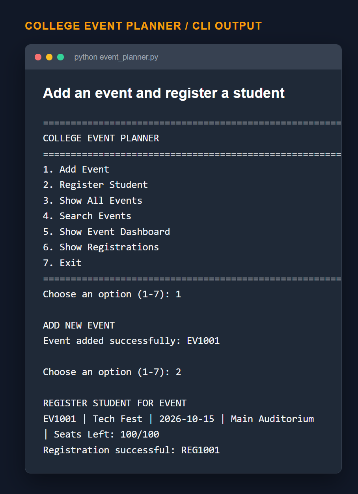
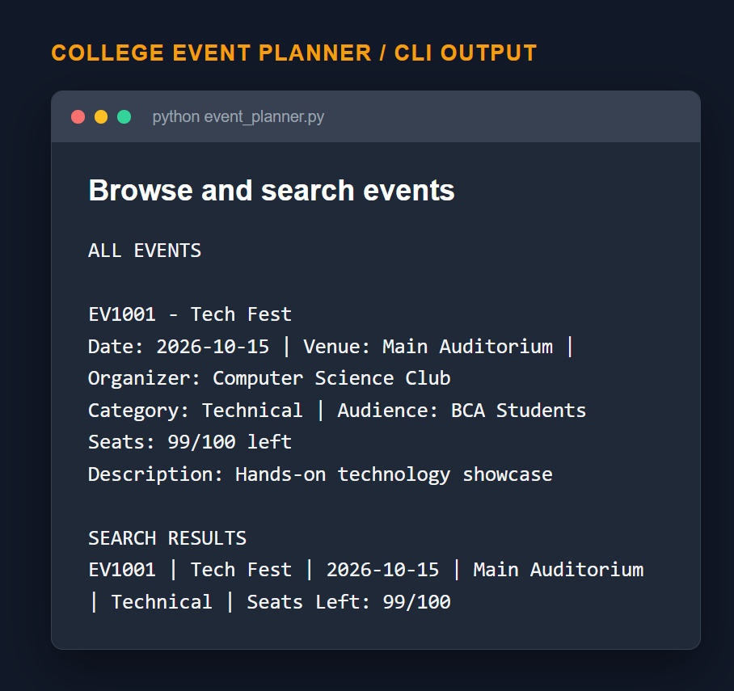
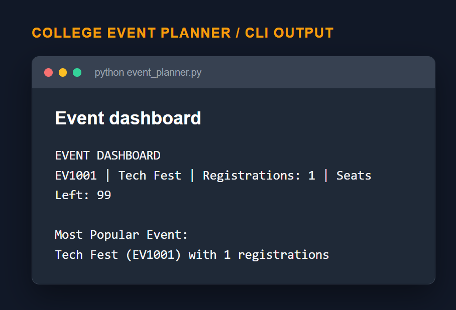
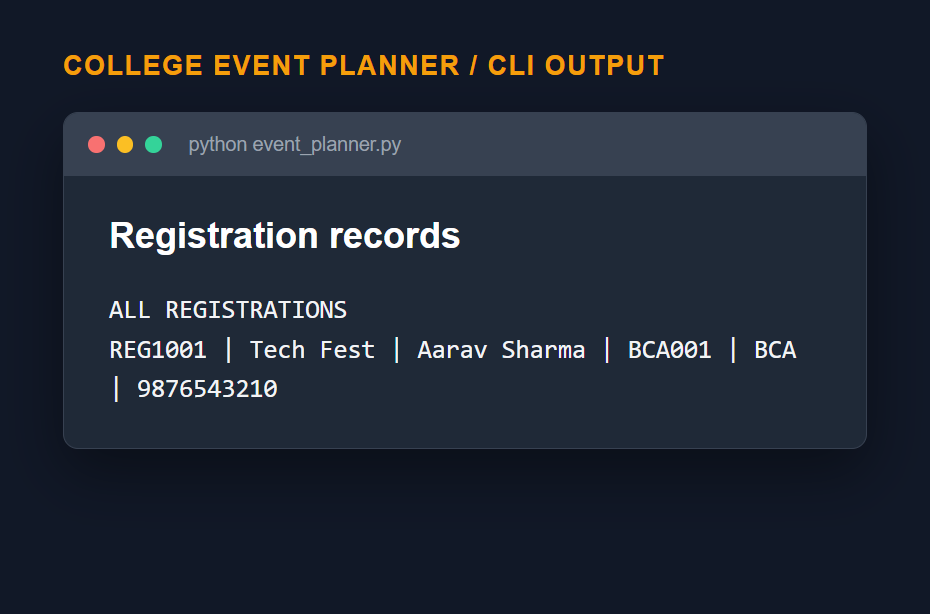

# College Event Planner

<<<<<<< HEAD
A college event manager with a **command-line app** and a **web page**, both using the same SQLite database (`event_planner.db`).

## Features

- Add events with date, venue, organizer(s), audience, category and seat capacity
- Register students and track seats left automatically (no overbooking)
- **Ratings & feedback (1-5 stars + comment) from registered students only**, one per student per event
- Search by name, venue, organizer or category; filter by category
- Dashboard: total registrations, most popular event, top-rated event
- **Day / night mode** with a pink palette (remembers your choice, follows your device by default)
- Home page with a hero banner and search, quick stats, category chips, and ticket-style event cards showing seats left

## Setup

```bash
pip install -r requirements.txt
```

## Run the web page

```bash
python app.py
```
Open http://127.0.0.1:5000

Optional sample data: `python seed_data.py`

## Run the command-line version
=======
A simple Python command-line mini-project for managing college events and student registrations.

## Features

- Add college events with date, venue, organizer, audience, category, and seat capacity.
- Register students for an event.
- Track seats left automatically.
- Search events by name, venue, organizer, or category.
- Show all events and a dashboard with total registrations.
- Show the most popular event based on registration count.

## Run
>>>>>>> feffcf6a718c68e105a5b96ef23f469a584969d4

```bash
python event_planner.py
```

<<<<<<< HEAD
## How "registered students only" works

To rate an event, a student enters their **roll number and the phone number they registered with**.
The app checks that this pair is registered for *that* event, and allows one rating per registration.
(This is a simple check suited to a mini-project, not full login security.)

## Database tables

`events`, `organizers`, `event_organizers`, `students`, `registrations`, `feedback`

## Colour palette

| Mode  | Colours |
|-------|---------|
| Day   | Bubblegum Pink `#ff758f`, Cotton Candy `#ff8fa3`, Cherry Blossom `#ffb3c1`, Pastel Petal `#ffccd5` |
| Night | Night Bordeaux `#590d22`, Dark Amaranth `#800f2f`, Cherry Rose `#a4133c` |
=======
## Screenshots

The CLI supports event creation, student registration, event search, dashboard summaries, and registration tracking.

### Add Events and Register Students



### Browse and Search Events



### Event Dashboard



### Registration Records



## Project Data

The project automatically stores data in:

- `data/events.json`
- `data/registrations.json`
>>>>>>> feffcf6a718c68e105a5b96ef23f469a584969d4
