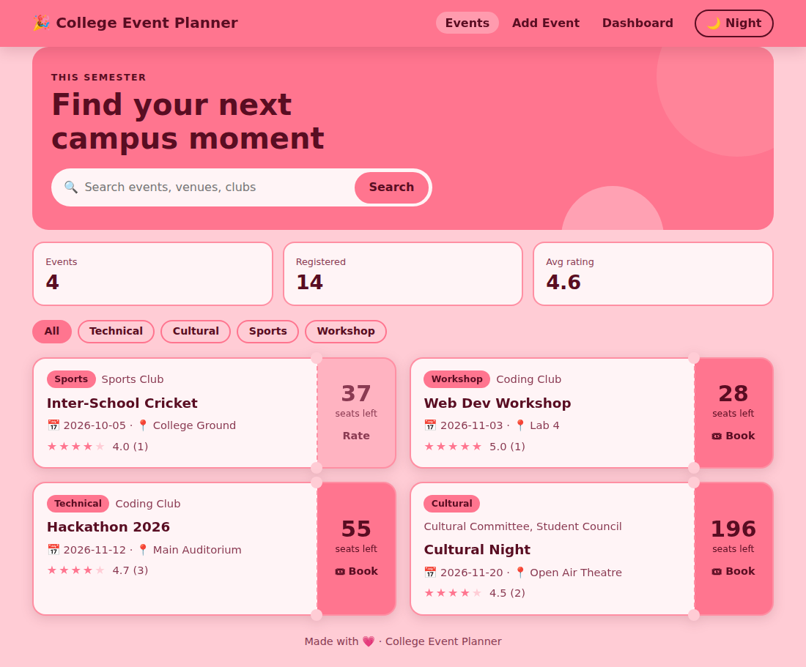
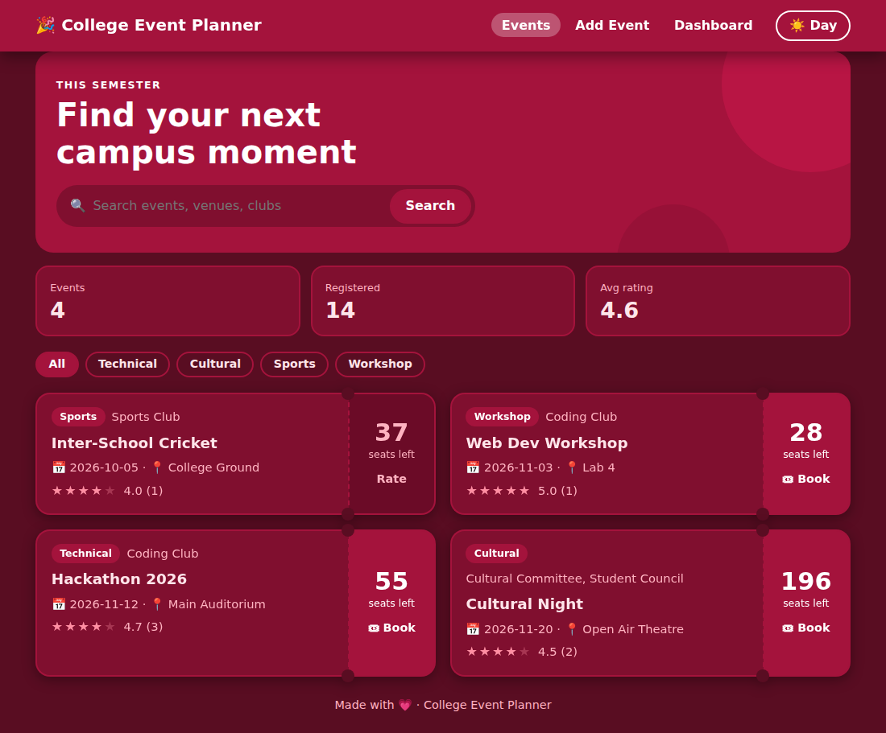
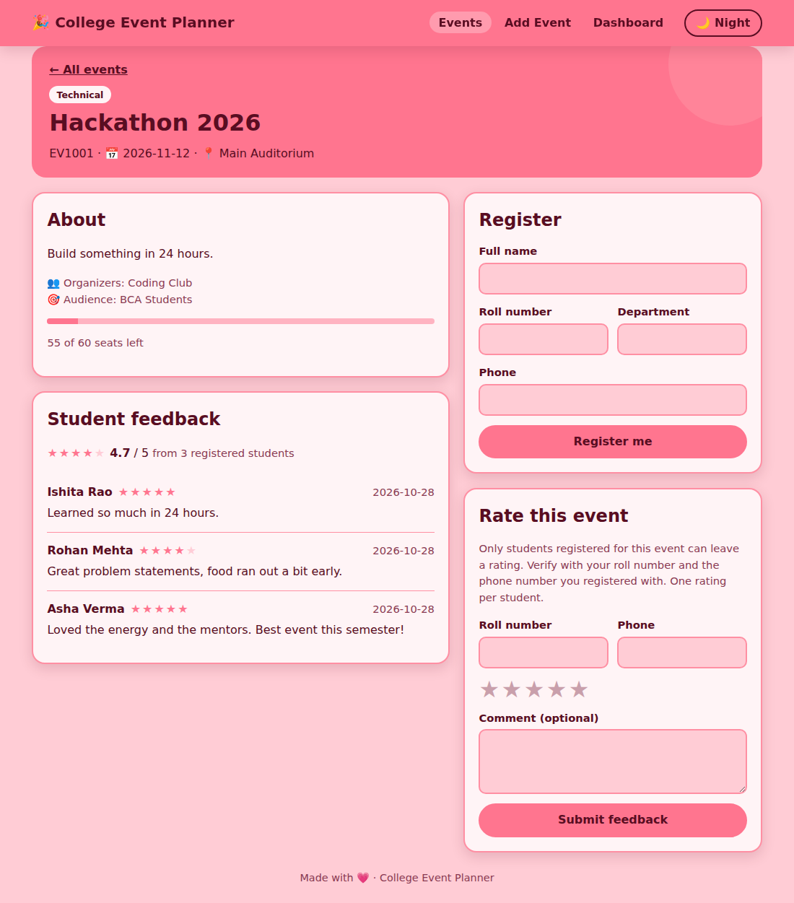
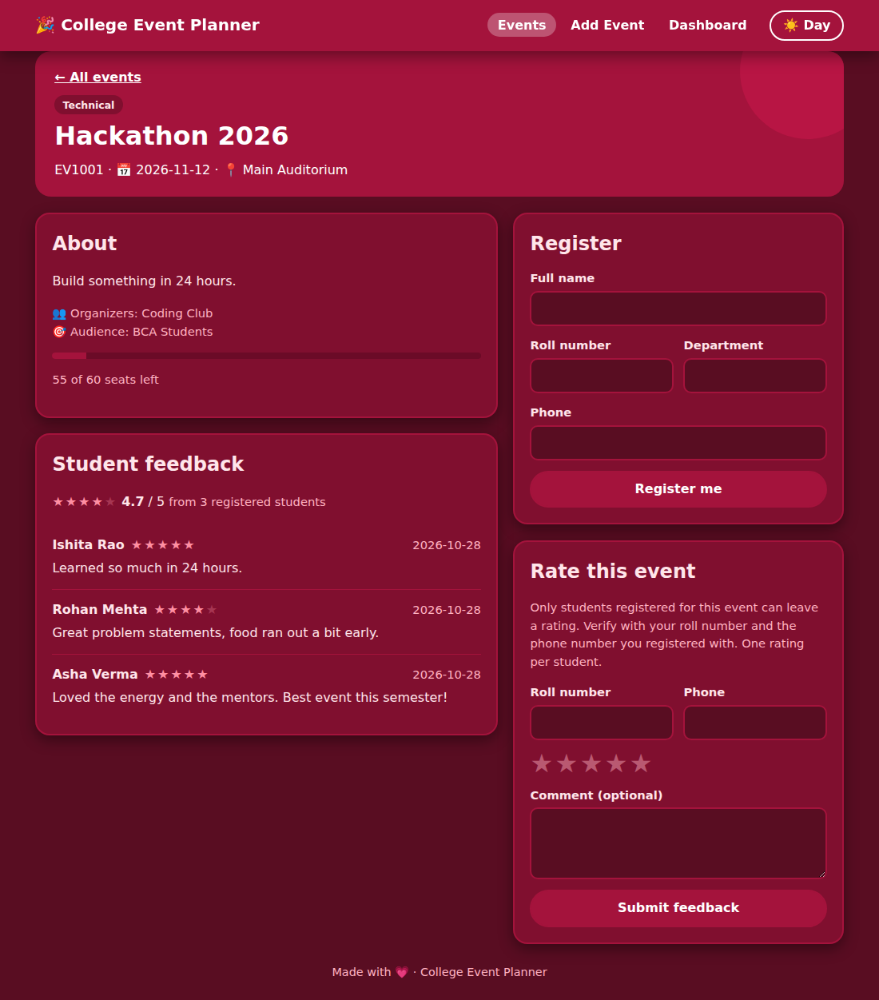
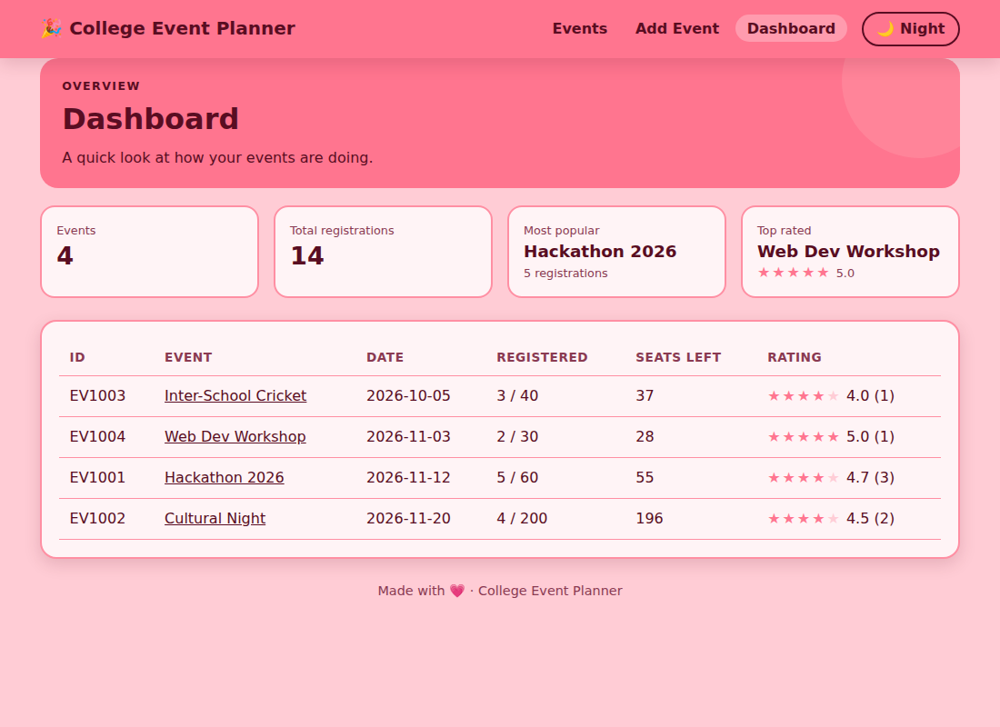
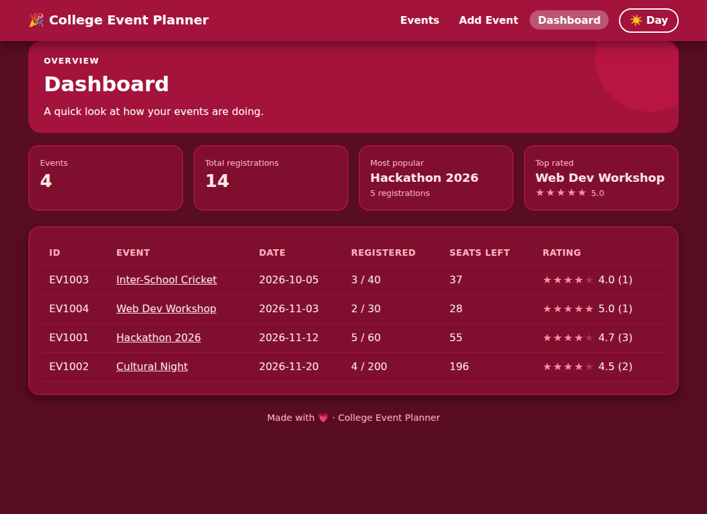

# College Event Planner

A college event manager with a **web page** and a **command-line app**, both using the same SQLite database. Students can browse events, register, and rate the events they attended. Only registered students can leave a rating.



## Features

- Add events with date, venue, organizer(s), audience, category and seat capacity
- Register students and track seats left automatically (no overbooking)
- Ratings and feedback (1 to 5 stars plus a comment) from **registered students only**, one per student per event
- Search by name, venue, organizer or category, and filter by category chips
- Dashboard with total registrations, most popular event and top-rated event
- Day and night mode in a pink palette (remembers your choice, follows your device by default)
- Command-line version with the same features

## Screenshots

### Home page

| Day | Night |
|-----|-------|
|  |  |

A hero banner with search, quick stats, category filters and ticket-style event cards that show seats left.

### Event page: register and rate

| Day | Night |
|-----|-------|
|  |  |

### Dashboard

| Day | Night |
|-----|-------|
|  |  |

The screenshots use sample data from `seed_data.py` plus a few demo registrations and ratings.

## Setup

```bash
pip install -r requirements.txt
```

## Run the web page

```bash
python app.py
```

Open http://127.0.0.1:5000. Press Ctrl+C in the terminal to stop it.

Optional sample events: `python seed_data.py`

## Run the command-line version

```bash
python event_planner.py
```

## How "registered students only" works

To rate an event, a student enters their **roll number and the phone number they registered with**. The app checks that this pair is registered for that event, and allows one rating per registration.

This is a simple check suited to a mini-project, not full login security.

## Project structure

```
app.py               Flask web app (routes)
event_planner.py     Database logic and command-line app
seed_data.py         Optional sample events
templates/           HTML pages (Jinja)
static/              style.css and theme.js (day/night toggle)
docs/screenshots/    Images used in this README
event_planner.db     SQLite database (created automatically, not in git)
```

Database tables: `events`, `organizers`, `event_organizers`, `students`, `registrations`, `feedback`

## Colour palette

| Mode  | Colours |
|-------|---------|
| Day   | Bubblegum Pink `#ff758f`, Cotton Candy `#ff8fa3`, Cherry Blossom `#ffb3c1`, Pastel Petal `#ffccd5` |
| Night | Night Bordeaux `#590d22`, Dark Amaranth `#800f2f`, Cherry Rose `#a4133c` |

## Privacy note

The database holds student names, roll numbers and phone numbers, so `event_planner.db` is listed in `.gitignore`. Don't commit it to a public repository.
